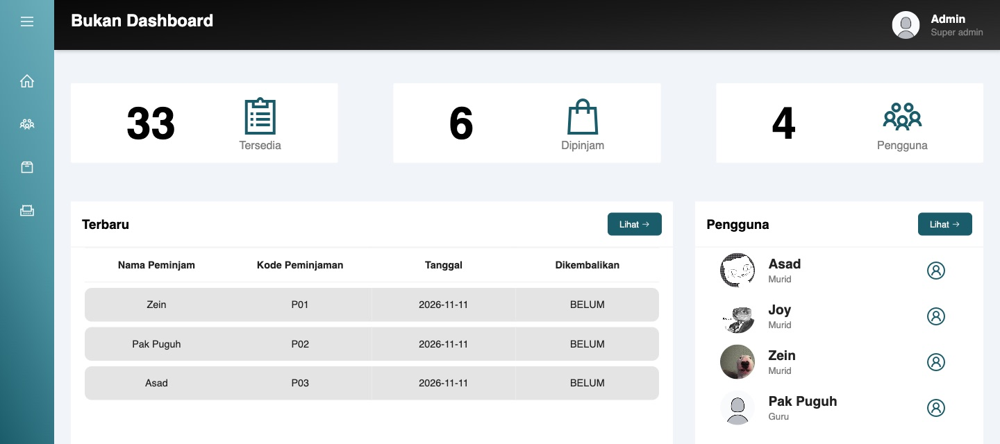
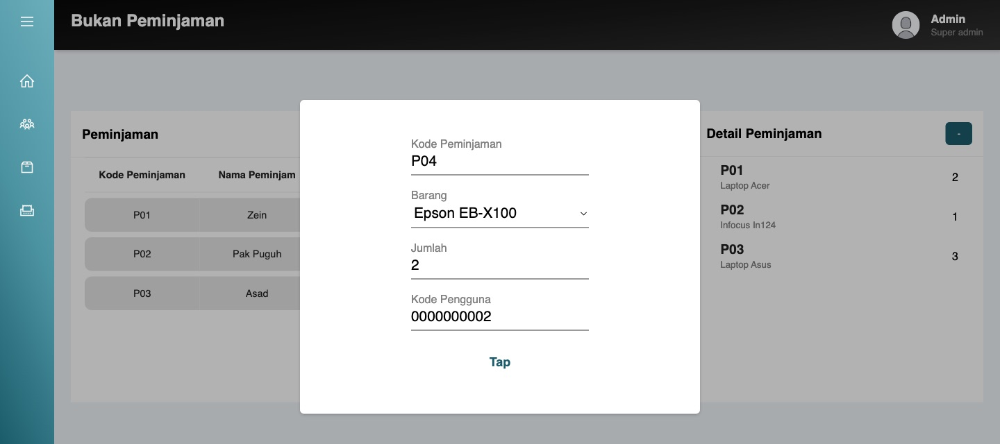
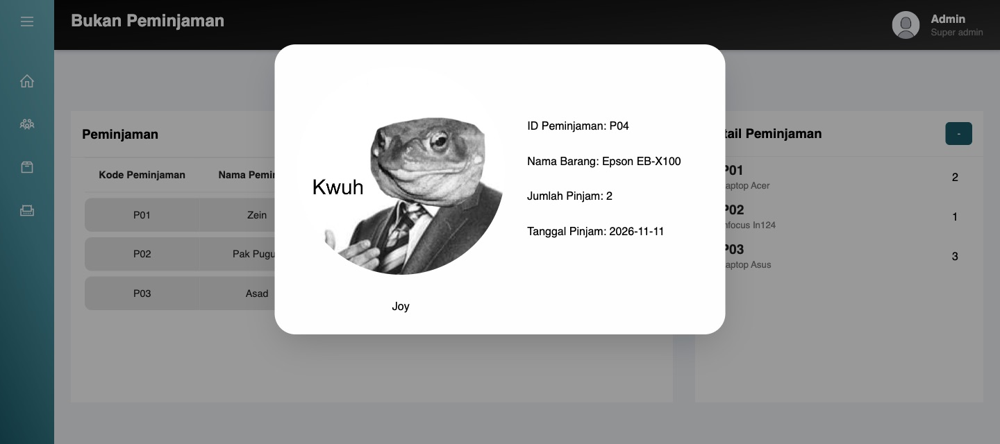
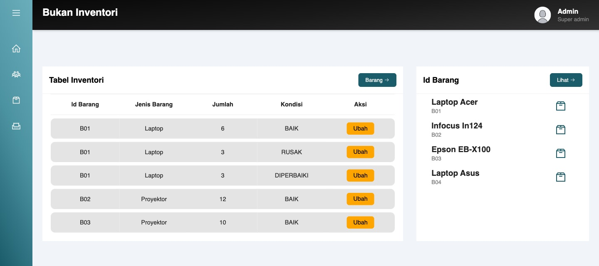

# Nugas Tap-Tap

A lending system for school equipment. A student taps their ID card on an RFID reader, the laptop or projector is booked out, and a receipt with their photo pops up — no page refresh. The database keeps the stock count right on its own.

Built in 2021 as a school assignment for the Uji Level exam, revisited in 2026.

**[See the showcase →](https://claude.ai/artifact/1aFtErDvnfHgw3awLLPmFj)** (live demo, every page, schema, and the story behind it)



| Loan form | Receipt |
| --- | --- |
|  |  |

## How the tap works

The USB RFID reader acts as a keyboard: it types the card number into **Kode Pengguna** and presses Enter. The form's submit button is hidden on purpose, so the tap itself submits the loan. jQuery AJAX sends it to `server_action.php`, which saves the loan and returns the receipt straight into the modal.

## Features

- **Borrow by card tap**, with an instant receipt that shows the borrower's photo for a quick face check.
- **Stock that counts itself.** MySQL triggers lower stock on loan, raise it on return, and cancel a loan that would push stock below zero.
- **Condition tracking.** Each item is split into `BAIK`, `RUSAK` and `DIPERBAIKI` (good, broken, in repair). Only good units count as available.
- **Borrowers** registered as Murid, Guru or Ruang, with card number and photo upload.
- **Admin panel** to add, edit and delete items, inventory, loans, borrowers and staff, with a dashboard of totals.



## Built with

Native PHP (no framework) · MySQL 8 / MariaDB · jQuery AJAX · hand-written HTML & CSS · Line Awesome icons · USB RFID reader

## Database

Six tables in `db_ujilevel_starbhak_2021`: `barang`, `inventori`, `peminjaman`, `detail_peminjaman`, `pengguna`, `pegawai`.

The stock rules live in triggers:

| Trigger | When | What it does |
| --- | --- | --- |
| `mengurangi` | after insert on `detail_peminjaman` | lowers `barang.tersedia` by the amount borrowed |
| `pembatas` | after insert on `detail_peminjaman` | deletes the loan line again if availability went below zero |
| `tambah` | after delete on `detail_peminjaman` | adds the amount back to `barang.tersedia` |
| `hapus` | after update on `peminjaman` | when a loan is set to `SUDAH`, deletes its lines (which fires `tambah`) |
| `inventori2` | after update on `inventori` | sets availability to the total of `BAIK` units |

## Run it locally

Needs PHP 8.2+ and MySQL or MariaDB.

```bash
# 1. database (creates db_ujilevel_starbhak_2021)
mysql -u root -p < db_ujilevel_starbhak_2021.sql

# 2. credentials
cp uji_level_1/connect.example.php uji_level_1/connect.php   # then set your password

# 3. server
cd uji_level_1 && php -S localhost:8000
```

Open http://localhost:8000/home.php.

## 2021 → 2026

The 2026 revisit got it running again and tidied it up:

- Made the dump work on MySQL 8 and matched the `inventori` table to what the code expects.
- Rewrote the `inventori2` trigger, which pointed at a deleted column and broke every inventory edit.
- Moved all queries that take user input to prepared statements (SQL injection).
- Took `connect.php` out of git; `connect.example.php` ships instead.

Still on the to-do list: escaping output against XSS, and validating photo uploads.

## Credits

- **Joy** — stepped in when I was stuck on the tap feature and solved it with AJAX: tap, and the data updates without a refresh.
- **Zein** — a close friend who backed me the whole way.
- **Pak Puguh** — challenged me to build this, and lent the RFID reader and the cards.

Road to uang teachcast.
